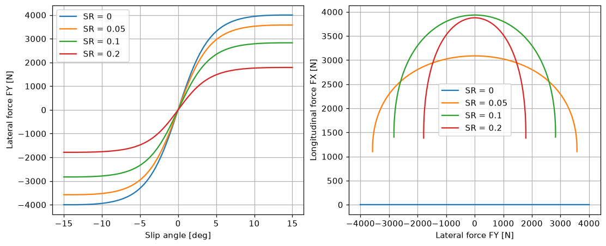

# magic-formula

A C++26 library and command-line tool for **Pacejka Magic Formula tire models**.

- An abstract base tire-model formulation, with concrete models **PAC2002** and **MF 5.2**. It is designed to be extended (e.g. MF 6.x).
- Index-mapped, vectorised batch evaluation with Eigen. Checks are opt-in (`throw_if_model_failure`).
- A CLI that reads a simulation input table (Fz, slip angle, slip ratio, inclination, Vx, …) and a `.tir` tire property file, then prints the tire forces and moments (Fx, Fy, Mz, Mx, My, …) for every input row.
- Python bindings (pybind11, NumPy) with an example Jupyter notebook.
- Verified by unit and module tests, with a 100% line and branch coverage gate on the core library.

<picture>
  <source media="(prefers-color-scheme: dark)" srcset="docs/images/web/workbench-dark.png">
  
</picture>

Examples: [web frontend walkthrough](docs/examples/web.md) · [Python bindings by example](docs/examples/python.md).

## Requirements

CMake >= 4.0, Ninja, Conan 2 (>= 2.9), and GCC >= 14 or Clang >= 19 (C++26). Windows (MSVC 19.4x, built as C++23) and macOS (Homebrew LLVM 21) are supported too, see "Platform support" below. Conan provides Eigen, GoogleTest and Google Benchmark. Coverage needs gcovr 8.x; GCC needs `gcov-<N>`, Clang needs `llvm-cov` and `libclang-rt-<N>-dev`.

## Build and test

```bash
conan profile detect --force        # once per machine
conan install . --build=missing -s build_type=Debug -s compiler.cppstd=26
cmake --preset debug
cmake --build --preset debug
ctest --preset debug --output-on-failure
./build/debug/mf --version          # prints "mf 0.1.0"
```

### Benchmarks

The release preset also builds `mf_bench` (Google Benchmark): per-point versus batch evaluation of PAC2002 and MF 5.2.

```bash
conan install . --build=missing -s build_type=Release -s compiler.cppstd=26 -o with_benchmark=True
cmake --preset release && cmake --build --preset release
./build/release/bench/mf_bench
```

## Web frontend (WebAssembly)

`web/` is a Vite + React + TypeScript + Tailwind + shadcn/ui + Recharts app that runs the existing C++ library in the browser, compiled to WebAssembly (Emscripten, embind adapter in `wasm/`). It loads, edits and saves `.tir` files, shows the model, and plots sweeps: several sweeps share one chart, each with its own swept input, up to two step variables and hue or saturation per step.

A step-by-step walkthrough with screenshots: [`docs/examples/web.md`](docs/examples/web.md).

<picture>
  <source media="(prefers-color-scheme: dark)" srcset="docs/images/web/characteristics-dark.png">
  
</picture>
<picture>
  <source media="(prefers-color-scheme: dark)" srcset="docs/images/web/coordinate-system-dark.png">
  
</picture>

The app is a full-width three-pane workbench on one page: Inputs | Plot | Tire model. The model summary and the parameter panel (grouped by section, filterable) sit next to the chart.

- **Inputs:** sweep tabs at the top of the Inputs pane with New, Duplicate, Remove and a name field (up to 6 sweeps per chart, default names "Sweep n"). Each sweep has its own swept input and range, up to 2 stepped inputs, held values and a pure-slip (uncombined) switch. Below the tabs, one row per model input (FZ, SA, SR, IA, VX, and P when the model has it), each with a Sweep / Step / Value switch; the roles apply per sweep. Exactly one input is swept; choosing Sweep on another input turns the old one into a held value.
- **Step values** are chips: add with Enter or the + button, remove with x, and "Range..." fills evenly spaced values. A step takes up to 8 values. Every combination is one line, coloured by Hue or Saturation per step.
- **Plot:** Plot and Table views. The X and Y axis selectors list Inputs, Outputs and Characteristics (the eight channels DFY_DSA, DFX_DSR, FY_OVER_SA, FX_OVER_SR, DY, DX, SA_AT_PEAK_FY, SR_AT_PEAK_FX), so any of them can be plotted (for example FY vs FX, MZ vs FY, or DFY_DSA vs SA). Lines follow the sweep order, so curves that are not monotonic in X plot correctly. Sweeps are told apart by a dash pattern per sweep and a legend grouped by sweep name; problems and solver errors are reported per sweep.
- **Characteristics:** computed by the C++ library through the WebAssembly module (no finite differences in the browser), and only while an axis shows one, because they cost much more than the forces: large characteristic charts can take seconds and block the page. The stiffnesses DFY_DSA and FY_OVER_SA are shown in N/deg (the CLI and Python report N/rad), SA_AT_PEAK_FY in deg, SR_AT_PEAK_FX without a unit, and the others in N. An undefined peak slip (no peak in the search range, or no contact) is a gap in the curve and '—' in the table and tooltip, never 0; an axis with no value at any point gets a note under the chart. After the ISO / SAE toggle the chart shows the characteristics of the converted model: results are re-evaluated, never sign-flipped in the browser. Definitions: [`docs/research/characteristics.md`](docs/research/characteristics.md).
- **Table:** one section per sweep. Cells without a value show '—'.
- **Parameters:** numeric coefficients accept only valid numbers (invalid input shows an error and is not applied). `[UNITS]` entries are dropdowns that list the SI unit, the only one the solver supports, plus common non-SI units shown as "not supported yet".
- **Coordinate system:** on load the panel shows the identified system (ISO, SAE or Mixed), the table of identification indicators and the warnings, next to a 3D view (three.js, loaded lazily, orbit controls, follows light and dark) of a simplified tire that shows the convention: the x, y and z axes, the Fx, Fy and Fz arrows, the Mx, My and Mz arcs, the slip angle, the inclination and the wheel spin. The ISO / SAE toggle converts the model: its coefficients flip sign (the parameter panel marks the changed entries and Save exports the converted `.tir`), and the FZ sweep values flip with the vertical axis. A Mixed model has no toggle pressed.
- **Theme:** a light/dark toggle in the header. The default follows the system setting and the choice is remembered in the browser.

Prerequisites: python3, Conan 2, CMake >= 4.0, Ninja, Node 24 and npm; network access once, to fetch the project-local Emscripten SDK. The bash scripts are macOS/Linux only.

```bash
bash wasm/setup-emsdk.sh          # once: installs Emscripten 5.0.7 into .emsdk/ (gitignored)
bash wasm/build.sh                # builds web/src/wasm/mf_wasm.js (wasm embedded, gitignored)
cd web && npm ci
npm run dev                       # http://localhost:5173
```

Tests (from `web/`): `npm test` (unit tests plus a Node smoke test that loads the built wasm and solves a sweep), `npm run test:unit`, `npm run test:smoke`, `npm run typecheck`, `npm run build`. The wasm module must be built first (`npm run dev` checks this).

UI tests: `npm run test:e2e` runs the Playwright tests in `web/e2e/` against the Vite dev server, using the locally installed Google Chrome (channel `chrome`). If Chrome is not installed: `npx playwright install chromium`, then `PLAYWRIGHT_CHANNEL=chromium npm run test:e2e`. The walkthrough spec `web/e2e/screenshots.spec.ts` drives and asserts the steps of the walkthrough page in light and dark and writes its captures to `web/test-results/screenshots/` (gitignored); the HTML report goes to `web/playwright-report/` (gitignored). `npm run docs:screenshots` regenerates the committed renderings in `docs/images/web/`.

The wasm module is outside the native build and the coverage gate. CI has no web or wasm job yet (follow-up).

## Code quality and coverage

```bash
cmake --build --preset debug --target clang-format_all   # formats in place
cmake --build --preset debug --target clang-tidy_all
cmake --preset coverage && cmake --build --preset coverage && cmake --build --preset coverage --target coverage
```

The coverage target runs the tests and gcovr with a 100% line and branch gate on `src/` and `include/`; reports are written to `coverage/`.

CI (`.github/workflows/ci.yml`) runs the format/tidy gates, builds and tests on Linux (GCC 14, Clang 19), Windows (MSVC, `windows-2025`) and macOS (`macos-15`, Homebrew LLVM 21), and runs the coverage gate with GCC 14 on Linux.

## Platform support

| Platform | Compiler | C++ standard | Notes |
|----------|----------|--------------|-------|
| Linux | GCC >= 14, Clang >= 19 | C++26 | the reference platform; the coverage gate runs here |
| Windows | MSVC (Visual Studio 2022, v143) | C++23 (`/std:c++latest`) | Conan's msvc settings stop at `cppstd=23` and CMake has no C++26 flag for MSVC; the root `CMakeLists.txt` falls back to 23 automatically. Configure from an MSVC developer prompt (Ninja generator). |
| macOS | Homebrew LLVM 21 (`brew install llvm@21`) | C++26 | AppleClang is not supported: its libc++ lacks floating-point `std::from_chars` and `std::views::join_with`. Link against Homebrew's libc++ (flags below). |

Windows (Developer PowerShell for VS 2022):

```powershell
conan profile detect --force
conan install . --build=missing -s build_type=Debug -s compiler.cppstd=23
cmake --preset debug
cmake --build --preset debug
ctest --preset debug --output-on-failure
```

macOS (Homebrew LLVM 21):

```bash
export CC=/opt/homebrew/opt/llvm@21/bin/clang CXX=/opt/homebrew/opt/llvm@21/bin/clang++
export SDKROOT=$(xcrun --show-sdk-path)
LINKFLAGS="['-L/opt/homebrew/opt/llvm@21/lib/c++','-L/opt/homebrew/opt/llvm@21/lib/unwind','-lunwind','-Wl,-rpath,/opt/homebrew/opt/llvm@21/lib/c++']"
conan profile detect --force
conan install . --build=missing -s build_type=Debug -s compiler.cppstd=26 \
  -c "tools.build:exelinkflags=${LINKFLAGS}" -c "tools.build:sharedlinkflags=${LINKFLAGS}" \
  -c "tools.build:defines=['_LIBCPP_DISABLE_AVAILABILITY']"
cmake --preset debug && cmake --build --preset debug && ctest --preset debug --output-on-failure
```

`_LIBCPP_DISABLE_AVAILABILITY` is needed because Homebrew builds libc++ with vendor availability annotations enabled: libc++ 21 would otherwise mark `std::from_chars(double)` unavailable for the macOS deployment target, even though the build links Homebrew's newer `libc++.dylib`.

`.gitattributes` forces LF line endings so test fixtures are byte-identical on every OS.

## CLI

```bash
mf [--uncombined] [--verbose] [--system=iso|sae] [--table-system=iso|sae] <inputs-table> <file.tir>
mf --help | -h
mf --version
```

`mf` evaluates the tire model described by `<file.tir>` at every row of `<inputs-table>` and prints Fx, Fy, Mz, Mx and My, the clamp flags and eight tire characteristics for every row as CSV on stdout.

| Option | Meaning |
|--------|---------|
| `--uncombined` | print the pure-slip outputs (Fx0, Fy0, Mz0) instead of the combined-slip ones |
| `--verbose` | print the model information and the ignored `.tir` keys on stderr |
| `--system=iso\|sae` | convert the model to this system before evaluating (its coefficients flip sign; only when its identified system differs). Default: evaluate the model as loaded, with no conversion |
| `--table-system=iso\|sae` | axis system of the input table and of the printed rows. Default: the evaluated model's loaded side (FNOMIN > 0 is ISO, FNOMIN < 0 is SAE), so the table is used as given. When it differs, FZ is flipped on the way in and FY, MZ and MY on the way out |
| `-h`, `--help` | print the usage text on stdout and exit |
| `--version` | print the version on stdout and exit |

### Coordinate systems

- **ISO:** x forward, y left, z up. A loaded tire has FZ > 0 and dFy/dSA > 0 at zero slip (FY < 0 for SA < 0).
- **SAE:** x forward, y right, z down. A loaded tire has FZ < 0 and dFy/dSA < 0 at zero slip.
- SA, SR and IA have the same physical definition in both systems (SA is positive when the wheel travels to the right of its heading; SR is positive when driving; IA is positive when the top leans to the right). FZ, FY, MZ and MY change sign between them; FX and MX do not.

**The equations never change.** Raw inputs go straight into the Magic Formula. A `.tir` file belongs to one system, and converting a model between ISO and SAE means flipping the signs of its coefficients (about 15 for the vertical axis, FNOMIN among them, and about 15 for the slip-angle convention, PKY1 among them, plus the FZ and SA range pairs). The conversion is exact and its own inverse. The tables are in [`docs/research/coordinate-systems.md`](docs/research/coordinate-systems.md).

**Identification.** The system of a model is identified from its evaluated behaviour, never from raw coefficient signs. The vertical axis (which FZ sign is loaded) and the lateral axis (the slip-angle convention) are decided separately by a weighted vote of several indicators at several loads: the sign of FNOMIN, camber thrust, rolling resistance, dFy/dSA, the odd part of Fy at several slip angles and dMz/dSA. dFx/dSR is only a consistency check. The result is ISO, SAE or Mixed, with warnings for undetermined axes, dissenting indicators and checks that fail. The repository's fixture family (`pac2002_S.tir` and the like) has FNOMIN > 0 but dFy/dSA < 0, so it is identified as Mixed (vertical ISO, lateral SAE); `pac2002_S_iso.tir` and `pac2002_S_sae.tir` are consistent ISO and SAE versions of it.

- The identification warnings of the evaluated model are always printed on stderr; `--verbose` also prints the identified system of the source model and every indicator reading.
- Without `--system` nothing is converted. `--system=iso` on the Mixed fixtures flips only the lateral coefficients.
- Table warning: FZ rows on the unloaded side of the table's system (FZ < 0 in an ISO table, FZ > 0 in an SAE table) are lift-off rows with zero forces and moments; one warning per table names the first such row.

```bash
mf inputs.csv model.tir                              # as loaded, no conversion
mf --system=sae inputs_sae.csv model_iso.tir         # evaluate an ISO model as SAE
mf --table-system=sae inputs_sae.csv model_iso.tir   # same rows, converted by the table system
```

### Models

The model is chosen from the `.tir` file:

- **PAC2002**: `PROPERTY_FILE_FORMAT = 'PAC2002'`.
- **MF 5.2**: `FITTYP = 6`, with `PROPERTY_FILE_FORMAT` absent or one of `'MF_05'`, `'USER'` (TNO MF-Tyre ADAMS user-tire form) or `'MF-TYRE'`.

MF 6.x and every other model give an error (see `docs/research/model-routing.md`). The rules behind the loader and the models (defaults, required keys, units, clamping, low speed, ...) are listed in [`docs/research/policies.md`](docs/research/policies.md).

### Input table

Plain text, one operating point per row:

- A line whose first non-blank character is `#` is a comment; blank lines are ignored.
- Fields are separated by any run of commas, blanks or tabs. The rule is the same on every line (header, unit line and rows), and the separators may be mixed.
- The first content line is the header: the column names only. The required columns are `FZ SA SR IA VX`; the optional column is `P` (pressure). Columns may be in any order and in any letter case, each at most once.
- The next content line is the unit line, which is mandatory: exactly one unit per header column, in header order, compared case-insensitively. Accepted units: `FZ` N; `SA` rad or deg; `SR` -; `IA` rad or deg; `VX` m/s; `P` Pa. Degrees are converted to radians once, when the table is read.
- `P` is read but ignored with a warning (`column P is ignored: <model> has no P input`), because PAC2002 and MF 5.2 have no pressure input.
- Every further line is a data row with exactly as many numbers as the header has columns.

Errors (reported as `mf: error: <file>:<line>: <message>`, exit code 1, nothing on stdout):

- Missing unit line: the text ends after the header (reported at the header line), or the line after the header starts with a number (reported at that line).
- Unit count: the unit line has a different number of units than the header has columns. An empty entry such as `N,,rad` collapses and counts as a missing unit.
- Unsupported unit: an unknown unit (for example `kN`) or another column's unit (for example `deg` for `FZ`); the message names the column.
- Legacy header: a header field with brackets, such as `FZ[N]`, is a syntax error.

Migration: headers of the old form `FZ[N],SA[deg],...` are rejected. Write the bare names `FZ,SA,...` and move each unit to a unit line directly below the header.

Example:

```
# Fz in N, angles in degrees, Vx in m/s
FZ,SA,SR,IA,VX
N,deg,-,deg,m/s
4000,0,0,0,16.7
4000,4,0,0,16.7
3000,2,-0.1,1,25
```

### Output

CSV on stdout. The header line is

```
FZ[N],SA[rad],SR[-],IA[rad],VX[m/s],FX[N],FY[N],MZ[N*m],MX[N*m],MY[N*m],FZ_CLAMPED[-],SR_CLAMPED[-],SA_CLAMPED[-],IA_CLAMPED[-],BELOW_VXLOW[-],DFY_DSA[N/rad],DFX_DSR[N],FY_OVER_SA[N/rad],FX_OVER_SR[N],DY[N],DX[N],SA_AT_PEAK_FY[rad],SR_AT_PEAK_FX[-]
```

The results header keeps the `NAME[unit]` form (the units of the echoed inputs, of the outputs and of the characteristics); the input table has its units on the unit line instead.

23 columns, followed by one line per input row, in input order. The inputs are echoed unclamped in SI units (angles in rad), followed by the five outputs, five 0/1 flag columns and the eight characteristics. The characteristics are `DFY_DSA` and `DFX_DSR` (the instantaneous cornering and longitudinal stiffness, the slopes of the evaluated forces), `FY_OVER_SA` and `FX_OVER_SR` (the secant stiffnesses, evaluated force over the raw slip; at zero slip they equal the slopes), `DY` and `DX` (the pure-slip peak forces) and `SA_AT_PEAK_FY` and `SR_AT_PEAK_FX` (the first slip, from 0 on the side of the row's slip, where the force peaks). `nan` appears only in `SA_AT_PEAK_FY` and `SR_AT_PEAK_FX` (no peak in the search range, or no contact); it is a value, not an error. The echoed inputs, the outputs and the characteristics are in the table system (default: the evaluated model's loaded side; in ISO My is negative when the wheel rolls forward; see "Coordinate systems"); the flags are unchanged. The flag columns are `FZ_CLAMPED`, `SR_CLAMPED`, `SA_CLAMPED` and `IA_CLAMPED` are 1 when that input was clamped to the `.tir` range, and `BELOW_VXLOW` is 1 when Vx is below `VXLOW`. Warnings about the flags are still printed on stderr. Nothing is written to stdout unless every row evaluated successfully.

### Diagnostics and exit codes

Diagnostics go to stderr:

- `mf: error: <file>:<line>: <message>` for a failure (`<file>:<line>` is omitted when there is no location).
- `mf: warning: ...` for everything that does not stop the run: load warnings, the ignored `P` column, the coordinate-system warnings (the model identification and the load side of the table), and one warning per variable when inputs were clamped to the `.tir` ranges or Vx is below `VXLOW` (it names the first table line and the number of rows).
- `mf: info: ...` lines with `--verbose`, including the identified system of the source model with every indicator reading, the conversion applied and the table system.

Order on stderr: load warnings, model identification warnings, `--verbose` information, ignored columns, the FZ-sign warning, flag warnings.

An input outside the model domain is an error that names the column, for example `VX = -1 m/s is outside the PAC2002 domain (VX >= 0)` or `VX = 0 m/s is outside the MF 5.2 domain (VX > 0)`; a non-finite value gives `VX is not finite (...)`.

| Exit code | Meaning |
|-----------|---------|
| 0 | success (also `--help` and `--version`) |
| 1 | error: file, model, input table or evaluation problem |
| 2 | usage error (message and usage text on stderr) |

See [`docs/architecture.md`](docs/architecture.md) for the architecture (layers, class hierarchy, evaluation pipeline, error model, and how to extend to MF 6.x) and `CLAUDE.md` for the project layout.

## Library API

Besides the four `evaluate` forms, every model has `evaluate_characteristics`, `evaluate_characteristics_batch` and `characteristics_length()`. The characteristics are analytic (exact forward-mode derivatives of the closed-form equations, no finite differences). Derivation and policies: [`docs/research/characteristics.md`](docs/research/characteristics.md).

## Python bindings

`python/` holds a pybind11 extension that statically embeds the library, plus a thin Python layer, so the tire models can be evaluated on NumPy arrays. The package is `magic-formula` (import `magic_formula`), Python >= 3.11.

A walkthrough with rendered plots is in [`docs/examples/python.md`](docs/examples/python.md); every snippet runs in the test suite and its outputs are checked. Regenerate the figures with `.venv/bin/python python/examples/run_examples_page.py`.



```bash
conan install . --build=missing -s build_type=Release -s compiler.cppstd=26 -o with_benchmark=False
python3.12 -m venv .venv          # python3.12 or 3.13
CC=gcc-14 CXX=g++-14 .venv/bin/python -m pip install ./python
```

```python
import numpy as np
import magic_formula as mf

tire = mf.load_tir("tests/data/pac2002_S_iso.tir")
alpha = np.deg2rad(np.linspace(-15, 15, 301))
res = tire.evaluate(fz=4000.0, sa=alpha, sr=0.0, ia=0.0, vx=10.0)   # dict of arrays, e.g. res["fy"]

points = np.array([[4000.0, 0.0, 0.1, 0.0, 10.0]])   # (N, 5): FZ, SA, SR, IA, VX
out = tire.evaluate_batch(points)                    # (N, 10) float64

info = tire.find_coordinate_system()                 # classification, per-axis decisions, readings, warnings
sae_model = tire.convert_coordinate_system("SAE")    # a new TireModel with flipped coefficients
sae_points = tire.convert_inputs(points, source="ISO", target="SAE")   # FZ flips
res = sae_model.evaluate_batch(sae_points)           # raw evaluation; warns on rows on the unloaded side
```

The characteristics API: `TireModel.characteristic_channels` (name and unit of the eight channels), `characteristics_batch(inputs, *, check=True)` (an `(N, 8)` array) and `characteristics(*, check=True, **inputs)` (a dict of arrays keyed by the lower-case channel names, for example `res["dfy_dsa"]`). `nan` appears only in `sa_at_peak_fy` and `sr_at_peak_fx`.

The coordinate API: `TireModel.find_coordinate_system()`, `convert_coordinate_system(target)`, `convert_inputs` / `convert_outputs`, and `evaluate_batch(inputs, *, check=True)`, which warns (`MagicFormulaWarning`) about rows on the unloaded side of the model.

An example notebook is in `python/examples/magic_formula_demo.ipynb` (committed without outputs; the test suite executes it). Run the tests with `.venv/bin/python -m pip install "./python[test]"` and `.venv/bin/python -m pytest python/tests`. The API, errors, warnings and the macOS and Windows notes are in [`python/README.md`](python/README.md).

## Development with Claude Code agents

Development in this repository is driven by a team of Claude Code agents (`.claude/agents/`). Skills (`.claude/skills/`) hold the shared knowledge, and saved workflows (`.claude/workflows/`: `feature`, `review`) chain the agents together. The main session runs as the `orchestrator`. It dispatches architect -> planner -> developers -> test-runner -> reviewer and checks the result against the request. All changes land through pull requests; nothing is committed to `master` directly.

See [`CLAUDE.md`](CLAUDE.md) for the agent roster, the workflow, the commands and the project rules.

## License

magic-formula is licensed under the [Apache License, Version 2.0](LICENSE); attribution notices are in [`NOTICE`](NOTICE). Dependencies fetched by Conan, pip and npm keep their own licenses. Third-party material committed in the tree keeps its own terms: the MFeval reference data is described in [`tests/data/reference/README.md`](tests/data/reference/README.md), and `web/src/components/ui/` is generated from shadcn/ui (MIT).
