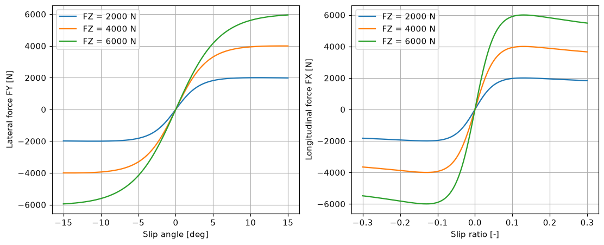
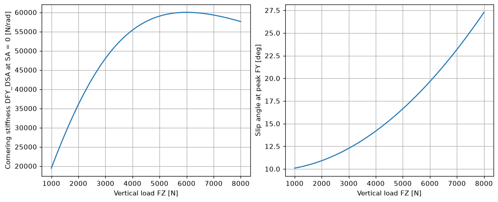
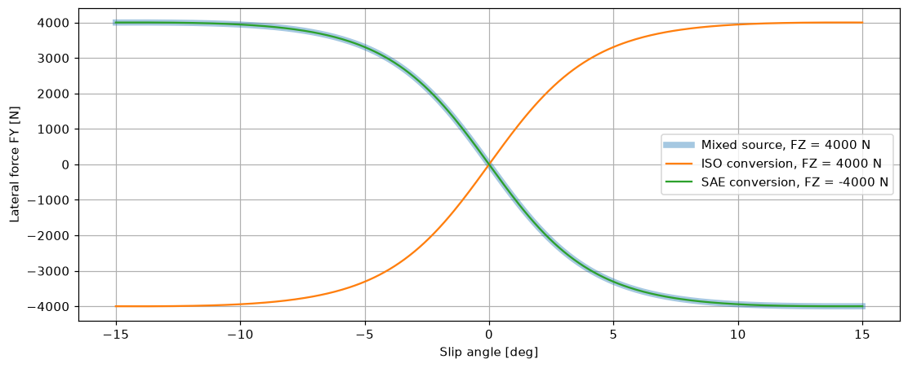

# Python bindings by example

This page walks through the `magic_formula` Python package with snippets that run in order, in one Python session,
from the repository root (the data paths are `tests/data/...`). Every snippet below is executed by the test suite, and
every output and figure shown is the real one.

The `.tir` files used here are the repository's synthetic test fixtures, so the curves are not those of a real tire.

Further reading: [`python/README.md`](../../python/README.md) (install, full API, macOS and Windows notes) and the
notebook [`python/examples/magic_formula_demo.ipynb`](../../python/examples/magic_formula_demo.ipynb).

## Setup

The `[test]` extras bring matplotlib, which the plots need. On macOS, follow [`python/README.md`](../../python/README.md).

```bash
conan install . --build=missing -s build_type=Release -s compiler.cppstd=26 -o with_benchmark=False
python3.12 -m venv .venv          # python3.12 or 3.13
CC=gcc-14 CXX=g++-14 .venv/bin/python -m pip install "./python[test]"
```

## Load a model

`load_tir` reads a `.tir` file and picks PAC2002 or MF 5.2 from its content. The model is immutable and describes its
own channels: five inputs in a fixed column order and ten outputs.

```python
import numpy as np
import matplotlib.pyplot as plt
import magic_formula as mf

tire = mf.load_tir('tests/data/pac2002_S_iso.tir')
print(tire)
print(tire.name, tire.combined)
print('inputs: ' + ', '.join(f'{c.name} [{c.unit}]' for c in tire.inputs))
print('outputs: ' + ', '.join(f'{c.name} [{c.unit}]' for c in tire.outputs))
print('limits: ' + ', '.join(sorted(tire.limits)))
```

```text
TireModel(name='PAC2002', combined=True)
PAC2002 True
inputs: FZ [N], SA [rad], SR [-], IA [rad], VX [m/s]
outputs: FX [N], FY [N], MZ [N*m], MX [N*m], MY [N*m], FZ_CLAMPED [-], SR_CLAMPED [-], SA_CLAMPED [-], IA_CLAMPED [-], BELOW_VXLOW [-]
limits: ALPMAX, ALPMIN, CAMMAX, CAMMIN, FZMAX, FZMIN, KPUMAX, KPUMIN, VXLOW
```

## Force curves with broadcasting

`evaluate` takes one keyword per input channel. Scalars and arrays broadcast with the usual NumPy rules, so a column of
loads against a row of slip angles gives one curve per load. Angles are in radians and the results are in the model's
own axis system (ISO here).

```python
fz = np.array([[2000.0], [4000.0], [6000.0]])
alpha = np.deg2rad(np.linspace(-15.0, 15.0, 301))
kappa = np.linspace(-0.3, 0.3, 301)

lateral = tire.evaluate(fz=fz, sa=alpha, sr=0.0, ia=0.0, vx=10.0)
longitudinal = tire.evaluate(fz=fz, sa=0.0, sr=kappa, ia=0.0, vx=10.0)

for load, fy, fx in zip(fz[:, 0], lateral['fy'], longitudinal['fx']):
    print(f'FZ = {load:.0f} N: peak |FY| = {np.abs(fy).max():.0f} N, peak |FX| = {np.abs(fx).max():.0f} N')

fig, (ax_fy, ax_fx) = plt.subplots(1, 2, figsize=(10, 4), layout='constrained')
for load, fy, fx in zip(fz[:, 0], lateral['fy'], longitudinal['fx']):
    ax_fy.plot(np.rad2deg(alpha), fy, label=f'FZ = {load:.0f} N')
    ax_fx.plot(kappa, fx, label=f'FZ = {load:.0f} N')
ax_fy.set(xlabel='Slip angle [deg]', ylabel='Lateral force FY [N]')
ax_fx.set(xlabel='Slip ratio [-]', ylabel='Longitudinal force FX [N]')
ax_fy.legend()
ax_fx.legend()
ax_fy.grid(True)
ax_fx.grid(True)
plt.show()
```

```text
FZ = 2000 N: peak |FY| = 2000 N, peak |FX| = 2000 N
FZ = 4000 N: peak |FY| = 4000 N, peak |FX| = 4000 N
FZ = 6000 N: peak |FY| = 5951 N, peak |FX| = 6000 N
```



## Combined slip

A combined-slip model (the default) couples the two forces: slip ratio lowers the lateral force at the same slip angle.
The right-hand plot sweeps slip angle at fixed slip ratios and draws the resulting force pairs.

```python
sr_values = np.array([[0.0], [0.05], [0.1], [0.2]])
combined = tire.evaluate(fz=4000.0, sa=alpha, sr=sr_values, ia=0.0, vx=10.0)

fig, (ax_fy, ax_circle) = plt.subplots(1, 2, figsize=(10, 4), layout='constrained')
for ratio, fy, fx in zip(sr_values[:, 0], combined['fy'], combined['fx']):
    ax_fy.plot(np.rad2deg(alpha), fy, label=f'SR = {ratio:g}')
    ax_circle.plot(fy, fx, label=f'SR = {ratio:g}')
ax_fy.set(xlabel='Slip angle [deg]', ylabel='Lateral force FY [N]')
ax_circle.set(xlabel='Lateral force FY [N]', ylabel='Longitudinal force FX [N]')
ax_fy.legend()
ax_circle.legend()
ax_fy.grid(True)
ax_circle.grid(True)
plt.show()
```


## Batch evaluation

`evaluate_batch` takes an `(N, 5)` matrix whose columns follow `tire.inputs` (FZ, SA, SR, IA, VX) and returns an
`(N, 10)` matrix whose columns follow `tire.outputs`. A float64 matrix in Fortran order is passed to the library without
a copy; other layouts and dtypes are converted once.

```python
points = np.array(
    [
        [2000.0, 0.0, 0.05, 0.0, 10.0],
        [4000.0, 0.05, 0.0, 0.0, 10.0],
        [4000.0, 0.05, 0.1, 0.0, 10.0],
        [6000.0, -0.05, -0.1, 0.0, 10.0],
    ],
    order='F',
)
out = tire.evaluate_batch(points)

print('row        FX [N]     FY [N]    MZ [Nm]  flags')
for i, row in enumerate(out):
    flags = int(row[5:].sum())
    print(f'{i:3d} {row[0]:12.1f} {row[1]:10.1f} {row[2]:10.1f}  {flags}')
```

```text
row        FX [N]     FY [N]    MZ [Nm]  flags
  0       1544.0        0.0        0.0  0
  1          0.0     2376.4      -60.5  0
  2       3520.0     1680.4      -18.9  0
  3      -5280.0    -1949.1       20.3  0
```

## Characteristics

Characteristics are analytic quantities of the force curves: slopes, secants, peak forces and the slips at the peaks.
`characteristic_channels` lists them with their units. `characteristics` and `characteristics_batch` take the same
inputs as `evaluate` and `evaluate_batch`.

```python
print(', '.join(f'{c.name} [{c.unit}]' for c in tire.characteristic_channels))

load = np.linspace(1000.0, 8000.0, 71)
slope = tire.characteristics(fz=load, sa=0.0, sr=0.0, ia=0.0, vx=10.0)
peak = tire.characteristics(fz=load, sa=0.02, sr=0.0, ia=0.0, vx=10.0)

fig, (ax_slope, ax_peak) = plt.subplots(1, 2, figsize=(10, 4), layout='constrained')
ax_slope.plot(load, slope['dfy_dsa'])
ax_peak.plot(load, np.rad2deg(peak['sa_at_peak_fy']))
ax_slope.set(xlabel='Vertical load FZ [N]', ylabel='Cornering stiffness DFY_DSA at SA = 0 [N/rad]')
ax_peak.set(xlabel='Vertical load FZ [N]', ylabel='Slip angle at peak FY [deg]')
ax_slope.grid(True)
ax_peak.grid(True)
plt.show()

characteristics = tire.characteristics_batch(points)
for i, row in enumerate(characteristics):
    print(f'{i}: ' + ' '.join(f'{value:.4g}' for value in row))
```

```text
DFY_DSA [N/rad], DFX_DSR [N], FY_OVER_SA [N/rad], FX_OVER_SR [N], DY [N], DX [N], SA_AT_PEAK_FY [rad], SR_AT_PEAK_FX [-]
0: 3.22e+04 1.76e+04 3.22e+04 3.088e+04 2000 2000 0.1904 0.1299
1: 3.471e+04 7.155e+04 4.753e+04 7.155e+04 4000 4000 0.2476 0.1299
2: 2.454e+04 4608 3.361e+04 3.52e+04 4000 4000 0.2476 0.1299
3: 3.283e+04 6912 3.898e+04 5.28e+04 6000 6000 -0.3428 -0.1299
```



`NaN` appears only in the two peak-slip channels (`sa_at_peak_fy`, `sr_at_peak_fx`), when there is no peak in the slip
range or no contact.

## Coordinate systems

ISO has x forward, y left, z up (a loaded tire has FZ > 0 and dFy/dSA > 0). SAE has x forward, y right, z down (FZ < 0
and dFy/dSA < 0). `find_coordinate_system` identifies the system of a coefficient set from its evaluated behaviour, and
`convert_coordinate_system` returns a new model in the other system. Evaluation itself never converts anything.

```python
mixed = mf.load_tir('tests/data/pac2002_S.tir')
info = mixed.find_coordinate_system()
print(info.classification, info.vertical.sign, info.lateral.sign)
for message in info.warnings:
    print(message)

iso = mixed.convert_coordinate_system('ISO')
print(iso.find_coordinate_system().classification)
```

```text
MIXED POSITIVE NEGATIVE
coordinate system: the coefficients mix conventions: the vertical axis is ISO (a loaded tire has FZ > 0) but the lateral axis is SAE (dFy/dSA < 0); convert the model to ISO or SAE
ISO
```

`convert_inputs` and `convert_outputs` convert data rows between the two systems. Here an ISO table is evaluated by an
SAE model and its results are converted back; they match the direct ISO evaluation. In the plot the mixed source (wide, translucent) lies under the SAE curve, because its lateral axis is already SAE.

```python
sae = tire.convert_coordinate_system('SAE')
sae_points = tire.convert_inputs(points, source='ISO', target='SAE')
sae_out = sae.evaluate_batch(sae_points)
back = tire.convert_outputs(sae_out, source='SAE', target='ISO')
print(bool(np.allclose(back, out, rtol=1e-9, atol=1e-6)))

mixed_sae = mixed.convert_coordinate_system('SAE')
fig, ax = plt.subplots(figsize=(10, 4), layout='constrained')
ax.plot(np.rad2deg(alpha), mixed.evaluate(fz=4000.0, sa=alpha, sr=0.0, ia=0.0, vx=10.0)['fy'], linewidth=5, alpha=0.4, label='Mixed source, FZ = 4000 N')
ax.plot(np.rad2deg(alpha), iso.evaluate(fz=4000.0, sa=alpha, sr=0.0, ia=0.0, vx=10.0)['fy'], label='ISO conversion, FZ = 4000 N')
ax.plot(np.rad2deg(alpha), mixed_sae.evaluate(fz=-4000.0, sa=alpha, sr=0.0, ia=0.0, vx=10.0)['fy'], label='SAE conversion, FZ = -4000 N')
ax.set(xlabel='Slip angle [deg]', ylabel='Lateral force FY [N]')
ax.legend()
ax.grid(True)
plt.show()
```

```text
True
```



## Edit coefficients in memory

`parse_tir` builds a model from `.tir` text, so a coefficient can be changed without writing a file. The optional
`file_name` appears in error locations.

```python
from pathlib import Path

text = Path('tests/data/pac2002_S_iso.tir').read_text()
softer = mf.parse_tir(text.replace('LMUY = 1', 'LMUY = 0.8', 1), file_name='pac2002_S_iso_soft.tir')
for label, model in (('LMUY = 1.0', tire), ('LMUY = 0.8', softer)):
    fy = model.evaluate(fz=4000.0, sa=alpha, sr=0.0, ia=0.0, vx=10.0)['fy']
    print(f'{label}: peak |FY| = {np.abs(fy).max():.0f} N')
```

```text
LMUY = 1.0: peak |FY| = 4000 N
LMUY = 0.8: peak |FY| = 3200 N
```

## Errors and warnings

Library errors raise `MagicFormulaError` with a code, the location and, for batches, the failing row. A missing keyword
raises `TypeError`. Warnings about the loaded file are `MagicFormulaWarning`s and are also kept on `tire.warnings`.

```python
import warnings

try:
    tire.evaluate(fz=4000.0, sa=0.0, sr=0.0, ia=0.0, vx=-1.0)
except mf.MagicFormulaError as error:
    print(error.code, error.key, error.row)
    print(error)

try:
    tire.evaluate(fz=4000.0, sa=0.0, sr=0.0, ia=0.0)
except TypeError as error:
    print(error)

with warnings.catch_warnings():
    warnings.simplefilter('ignore', mf.MagicFormulaWarning)
    mf52 = mf.load_tir('tests/data/mf52_S52.tir')
print(mf52.name)
for message in mf52.warnings:
    print(message)
```

```text
INVALID_INPUT VX 0
row 0: VX = -1 m/s is outside the PAC2002 domain (VX >= 0)
evaluate() missing input(s) for PAC2002: vx
MF 5.2
tests/data/mf52_S52.tir:34: MF 5.2 ignores parameters that are not part of MF 5.2: LGAX, LGAY, LGAZ
```

## Regenerating

The figures and the outputs above come from the page itself. To re-run it and rewrite the images:

```bash
.venv/bin/python python/examples/run_examples_page.py
```

`pytest python/tests` runs every snippet of this page and checks the printed outputs, so CI does too.
