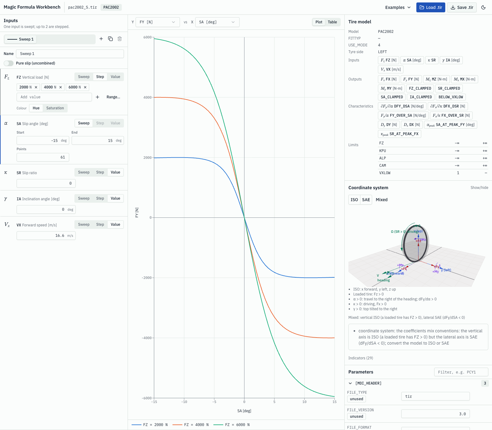
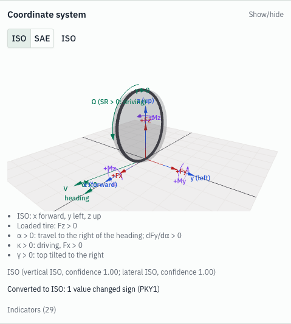
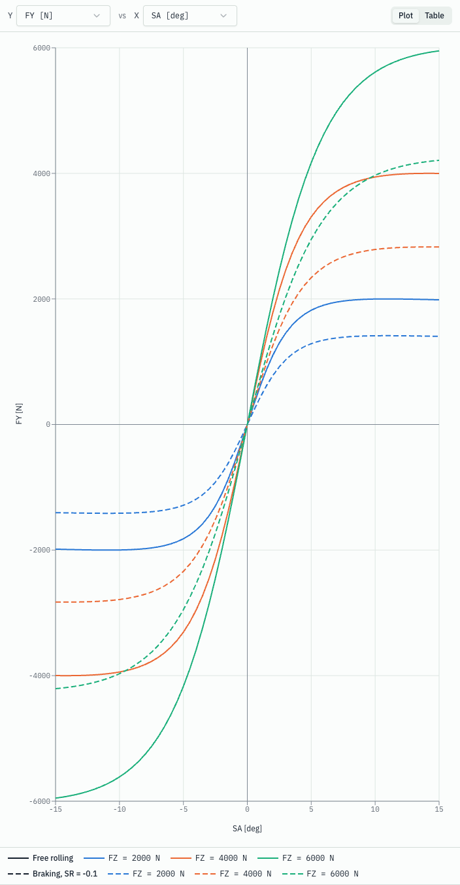
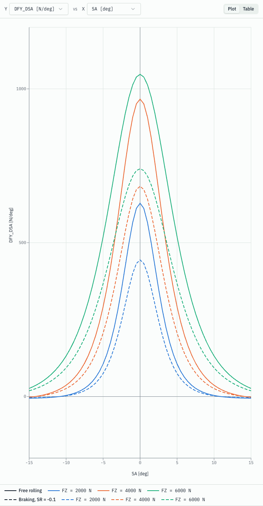
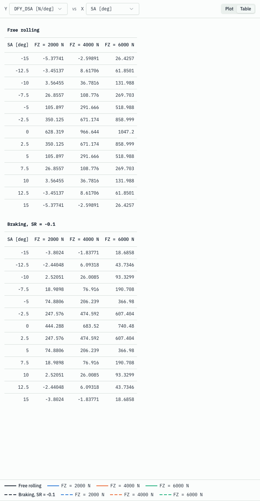

# Web frontend by example

The web app runs the C++ library in the browser, compiled to WebAssembly: there is no server-side solver. This page walks through one session, step by step. The bundled examples are the repository's synthetic test fixtures, so the curves illustrate the app and do not describe a real tire. Back to the [README](../../README.md#web-frontend-webassembly).

## Run the app

```bash
bash wasm/setup-emsdk.sh          # once: installs Emscripten 5.0.7 into .emsdk/ (gitignored)
bash wasm/build.sh                # builds web/src/wasm/mf_wasm.js (wasm embedded, gitignored)
cd web && npm ci
npm run dev                       # http://localhost:5173
```

## 1. Open an example

On the start screen, press "Open example pac2002_S.tir". The three-pane workbench opens: Inputs | Plot | Tire model. The plot shows three curves, one per load step, and the model is identified as a Mixed coordinate system.

<picture>
  <source media="(prefers-color-scheme: dark)" srcset="../images/web/workbench-dark.png">
  
</picture>

## 2. Identify and convert the coordinate system

The panel identifies the loaded model as Mixed. Pressing the ISO toggle converts the model: the coefficients that differ in convention flip sign (for this example one value, PKY1, and the parameter panel marks it as edited), the 3D view shows the ISO convention, and a conversion note appears.

<picture>
  <source media="(prefers-color-scheme: dark)" srcset="../images/web/coordinate-system-dark.png">
  
</picture>

## 3. Compare sweeps

Rename the sweep to "Free rolling", press Duplicate (the copy is selected), rename the copy to "Braking, SR = -0.1" and set its SR held value to -0.1. The chart now holds six curves. Each sweep has its own dash pattern, and the legend is grouped by sweep.

<picture>
  <source media="(prefers-color-scheme: dark)" srcset="../images/web/sweeps-dark.png">
  
</picture>

## 4. Plot a characteristic

Set the Y axis to DFY_DSA. It is shown in N/deg and computed by the library through WebAssembly, not by finite differences in the browser.

<picture>
  <source media="(prefers-color-scheme: dark)" srcset="../images/web/characteristics-dark.png">
  
</picture>

## 5. Read the values

Switch to the Table view: one section per sweep.

<picture>
  <source media="(prefers-color-scheme: dark)" srcset="../images/web/table-dark.png">
  
</picture>

## 6. Edit and save

The parameter panel marks the entries changed by a conversion. Numeric fields accept only valid numbers: invalid input shows an error and is not applied. Save .tir exports the converted file.

## Regenerating the screenshots

```bash
cd web && npm run docs:screenshots
```

The same spec runs on every `npm run test:e2e`, writing to the gitignored `web/test-results/screenshots/`. A test fails if this page or the README references a rendering that is not captured and committed.
